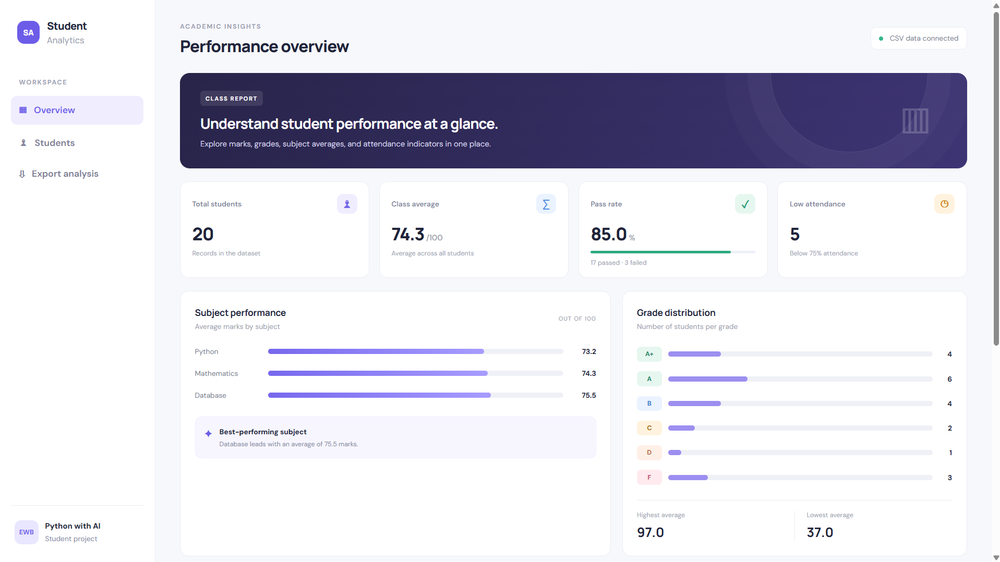
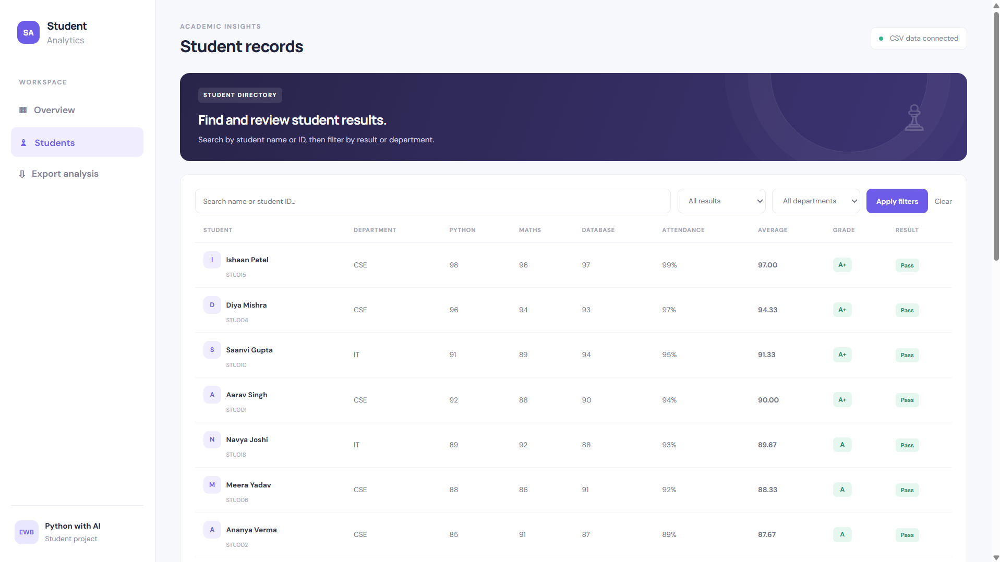
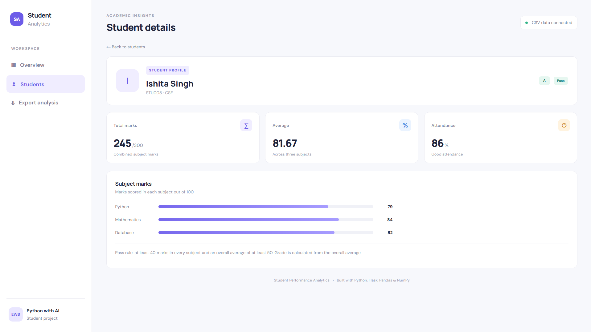

# Student Performance Analytics System

A beginner-friendly academic data-analysis dashboard built with Python, Flask, Pandas, NumPy, and CSV. It summarizes student marks, calculates grades and pass/fail status, compares subject averages, highlights top performers, and flags attendance below 75%.

**Author:** Awanish Sharma · EWB Courses — Python with AI

## Features

- Dashboard summary: student count, class average, pass rate, and low-attendance count
- Student list with search and filters for department and result
- Individual student performance pages
- Total marks, average marks, grade, and pass/fail calculation
- Subject-wise averages and grade distribution
- Export analyzed records as CSV
- Input validation for missing columns, duplicate IDs, invalid marks, and invalid attendance

## Screenshots







## Technology

- Python
- Flask
- Pandas
- NumPy
- CSV dataset
- HTML and CSS

## Dataset

`students.csv` contains 20 sample student records. Names and marks are illustrative sample data, not real institutional records. The three subjects are Python, Mathematics, and Database, each scored out of 100.

## Rules used

- Pass: a student must score at least 40 in **each** subject **and** have an overall average of at least 50.
- Grades based on average marks:
  - A+: 90–100
  - A: 80–89.99
  - B: 70–79.99
  - C: 60–69.99
  - D: 50–59.99
  - F: below 50
- Attendance below 75% is flagged as low. Attendance does not change the marks-based pass/fail result.

## Setup on Windows

1. Install Python 3.10 or newer.
2. Open this project folder in VS Code.
3. Open the VS Code terminal and create a virtual environment:

   ```powershell
   py -m venv .venv
   .venv\Scripts\activate
   ```

4. Install the required packages:

   ```powershell
   python -m pip install -r requirements.txt
   ```

5. Start the Flask application:

   ```powershell
   python app.py
   ```

6. Open `http://127.0.0.1:5000` in your browser.
7. Stop the local server with `Ctrl+C` in the terminal.

## Run tests

With the virtual environment activated:

```powershell
python -m unittest discover -s tests -v
```

## Project structure

```text
student-performance-analytics/
├── app.py
├── analytics.py
├── students.csv
├── requirements.txt
├── README.md
├── PROJECT_DOCUMENTATION.md
├── .gitignore
├── templates/
│   ├── base.html
│   ├── index.html
│   ├── students.html
│   ├── student_detail.html
│   └── 404.html
├── static/
│   └── style.css
├── screenshots/
│   ├── dashboard.png
│   ├── students.png
│   └── student_detail.png
└── tests/
    ├── test_analytics.py
    └── test_app.py
```

## Important notes

- This is an educational prototype, not a production student information system.
- The Flask development server is intended for local testing only. `debug=True` should not be used when deploying publicly.
- Replace or extend the sample dataset only with data you have permission to use. Do not upload private student information to a public repository.